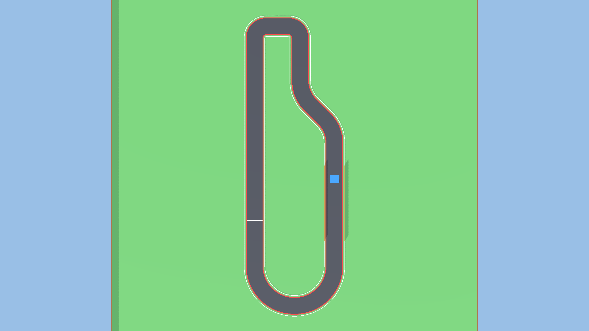

# Test Tracks

**Date:** 2026-11-26
**Owner request:** "create a second larger test map, suggest possible
layouts".

There are two maps:
- **Sandbox** (`scenes/arenas/test_track.tscn`): a 100 x 100 m arena. It
  is the default.
- **Tuning circuit** (`scenes/arenas/tuning_circuit.tscn`), new in
  T-035.

Switch maps with **F4** in game, or start on the circuit with
`task run:circuit`.

All maps follow [track-geometry.md](track-geometry.md):
- no low gaps
- solid ramps
- visible collision
- bounds taller than any jump

Sizes below are set by the handling. Top speed is 24 m/s. At full lock
the car turns on a 17 m radius at top speed and about 7 m at 10 m/s
(T-027). A 15-20 degree ramp gives about 1 s of air (T-030).

## Layout options

### A. Tuning Circuit — built (T-035)

```
        hairpin (2 x R10)
        ___________
       /           \
      |   start     |  chicane (2 x R30, 45 deg)
      |   straight   \_
      |   192 m        \
      |                 |  back straight
      |  S              |  with a 15 deg kicker
      |  =  start line  |  and 6.5 m jump walls
      |                 |
       \_____________ _/
         sweeper (R35, 180 deg)
```



A **571 m** closed lap on 90 x 265 m of ground. The road is 14 m wide,
with curbs and 1.2 m barriers.

| Section | Tests |
|---|---|
| 192 m start straight | top speed, speed FOV, boost FOV, boost pull-back |
| R10 U-hairpin | braking, low-speed steer fade, a tight drift (it is under the 17 m full-lock radius, so it is never flat-out) |
| R30 chicane | steer ramp, quick direction change, glancing walls |
| back straight + 15 degree kicker (8 m wide, so you can go round it) | ramp launch, hang time, trick window, landing |
| R35 180-degree sweeper | a long drift to tier 3, the drift camera |

**Pros:** it is a real lap, so it is ready for laps, checkpoints and 4
players later. Every handling system gets a section.

**Cons:** it is flat (no banking, no elevation), and there is only one
racing line.

### B. Figure-8 with an overpass

Two loops cross on a bridge. The bridge needs 2.5 m or more of
clearance and solid sides (track-geometry rules 1 and 3).

**Tests:** elevation, crests (launch off a hill, not a ramp), banking on
the approaches, and four-car crossing chaos.

**Cost:** an elevated road (Path3D heights) and a bridge. A crest launch
needs checking against T-030.

### C. Proving Grounds (drift bowl)

An open asphalt pad with stations:
- skidpad circles at R10, R20 and R35
- a pylon slalom
- a ramp ladder at 10, 15, 20 and 25 degrees
- a wall-angle gallery at 15, 30, 45 and 90 degrees

**Pros:** each station maps 1:1 to the scripted probes, so tuning
numbers are repeatable by hand.

**Cons:** it is not a race. Best as the third map, for tuning rounds.

### D. Party Arena

A circuit with a central hub and route choices:
- a risky shortcut through a narrow gap
- a jump over a gap (no-gap rule: a solid floor below)
- slots for spectator hazards later (`docs/design/spectator-system.md`)

**Tests:** close 4-player racing and the "Chaos with strategic depth"
pillar.

**When:** once items or spectator hazards exist.

### E. Hat Brim Speedway

A wide banked oval around a giant top hat landmark, for pack racing.

**Tests:** high-speed packs, the camera in traffic, and split-screen
readability. It also gives the game's identity a map.

**Cost:** banking (Path3D tilt) needs a check against T-030 and T-032.

## Recommendation

- **A now**: built.
- **C next**, as the tuning companion for FC-2 rounds.
- **D** once items or spectators land.
- **B** and **E** when elevation and banking are on the roadmap.

## Editing the tuning circuit

The layout is data: the `CORNERS` list in
`tools/build_tuning_circuit.gd`. Each entry is a corner point and an arc
radius, so the loop always closes. Run `task track:circuit` to
regenerate the scene.

The road, curbs and barriers are `CSGPolygon3D` extrusions along the
`Centerline` `Path3D`, so you can also drag Path3D points in the editor.
A regeneration overwrites such edits, so move those changes into
`CORNERS`.
